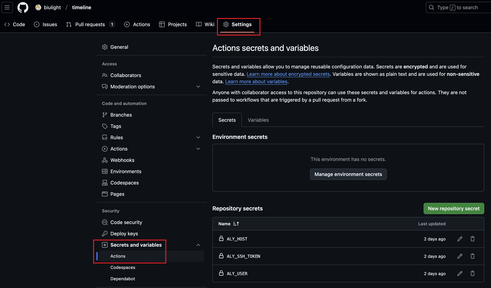

怎样通过 Github 自动交付前端编译产物？

<!--truncate-->

本文保留 2025 年的部署示例和 Action 版本。新建流水线请结合[可复用 GitHub Actions 流程](/developing/Deps/github-actions)选择当前受支持的版本。

其中 `ssh-deploy@v2.2.11` 的[实现](https://github.com/easingthemes/ssh-deploy/blob/v2.2.11/src/index.js)固定使用 `StrictHostKeyChecking=no`，不会严格验证服务器身份。不要把这个历史版本直接用于新的生产流水线；应采用支持校验已核实服务器公钥的部署方案。

## 准备

一台已安装 Nginx 和 rsync、可通过 SSH 登录的 Ubuntu 服务器。下文的账号、主机和 `/path/to/folder` 均需替换为自己的值，目标目录只用于这个站点。

## 实施

**以 `deploy` 用户组下的 `deploy001-timeline` 用户,部署目录 `/path/to/folder`，部署工具 `easingthemes/ssh-deploy@v2.2.11` 为例**

### 新建部署用户，修改部署目录权限

:::tip
遵循权限最小化原则，创建 `deploy001-timeline` 用户，用于部署
若已存在 `deploy` 用户组，跳过**步骤 1**，直接新建指定项目部署用户
:::

```bash
# 检查指定xxx用户组是否存在
getent group deploy
```

1. 创建用户组

```bash
sudo addgroup deploy
```

2. 创建用户

```bash
sudo adduser --ingroup deploy deploy001-timeline
```

3. 指定部署目录的归属

```bash
sudo mkdir -p /path/to/folder
sudo chown deploy001-timeline:deploy /path/to/folder
```

4. 更新目录权限

```bash
sudo chmod 755 /path/to/folder
```

### 配置部署工具

**以 `easingthemes/ssh-deploy@v2.2.11` 为例**

:::tip
[easingthemes/ssh-deploy](https://github.com/easingthemes/ssh-deploy)使用手册
:::

#### 服务器侧

:::tip
使用 `ssh` 登录服务器，需要使用一组秘钥对，其中公钥设置到服务器 `~/.ssh/authorized_keys` 文件中，私钥设置在客户端
:::

1. 登录新创建的用户

```bash
su - deploy001-timeline
```

2. 生成非对称密钥

```bash
ssh-keygen -m PEM -t rsa -b 4096 -f deploy001-timeline -C "deploy001-timeline"
```

此旧版 Action 没有私钥口令输入，专用自动化密钥的 passphrase 提示需留空。不要复用日常登录密钥；私钥只交给受保护的部署 Secret，并限制该部署账号的目录权限。若同名文件已存在，先确认用途，不要覆盖。

3. 把公钥粘贴到 `authorized_keys` 文件中

```bash
# 查看公钥，复制输出到终端的结果
cat deploy001-timeline.pub
# 编辑 authorized_keys 文件，并把复制的结果粘贴到此文件
mkdir -p ~/.ssh
chmod 700 ~/.ssh
vim ~/.ssh/authorized_keys
chmod 600 ~/.ssh/authorized_keys
```

```txt title="~/.ssh/authorized_keys"
ssh-rsa <你的部署公钥内容> deploy-user
```

:::tip
vim 是 linux 常用的终端编辑器，常见命令如下

1. `:wq` 保存并退出
2. `i` 进入输入视图
   :::

#### Github 配置

配置 `secrets` ，在 workflow 中使用

:::tip
配置位置如下图所示

:::

1. 新增 `ALY_USER`，如下

```txt
deploy001-timeline
```

2. 新增 `ALY_HOST`，如下

```txt
deploy.example.com
```

3. 新增 `ALY_SSH_TOKEN`，值为专用部署私钥的完整内容。不要复制他人的示例密钥，也不要把私钥写入仓库、截图或日志。

```txt
<粘贴专用于部署的完整私钥；不要写入仓库或文档>
```

:::tip

- **ALY_USER:** 服务器配置的部署用户名
- **ALY_HOST:** 服务器域名
- **ALY_SSH_TOKEN:** 通过`ssh-keygen` 生成的私钥
  :::

#### 项目 workflow 配置

:::tip
配置文件配置在项目中，通常写在 `.github/workflows` 目录下
:::

首次运行先保留下面的 `--dry-run`，检查输出中准备更新和删除的路径；确认备份及范围后，再去掉该选项进行真实部署。`--delete` 会删除目标目录中产物没有的文件，不要把目标设为共享目录。

**example:**

```yml title=".github/workflows/deploy.yml"
name: Deployment
# 触发脚本的条件：release 分支 push 时
on:
  push:
    branches:
      - release
# 要执行的任务
jobs:
  # 任务名称
  build:
    # runs-on 指定job任务运行所需要的虚拟机环境（必填）
    # runs-on: self-hosted
    runs-on: ubuntu-latest
    # 任务步骤
    steps:
      # 获取源码
      - name: pull code
        # 使用action库  actions/checkout获取源码
        uses: actions/checkout@v3
      # 安装node
      - name: create build environments
        # 使用action库 actions/setup-node 安装node
        uses: actions/setup-node@v3
        with:
          node-version: 18.20.4
      # 安装依赖
      - name: install
        run: npm install
      # 打包
      - name: build
        run: npm run build
      - name: Upload static files as artifact
        id: deployment
        uses: actions/upload-pages-artifact@v3 # or specific "vX.X.X" version tag for this action
        with:
          path: build/
      # 上传打包文件到远程服务器
      - name: ssh deploy
        uses: easingthemes/ssh-deploy@v2.2.11
        env:
          REMOTE_USER: ${{secrets.ALY_USER}}
          REMOTE_HOST: ${{secrets.ALY_HOST}}
          REMOTE_PORT: "22"
          ARGS: "-rltgoDzvO --delete --dry-run"
          SSH_PRIVATE_KEY: ${{secrets.ALY_SSH_TOKEN}}
          # 要上传文件所在目录
          SOURCE: "build/"
          # 远程服务器目标路径
          TARGET: "/path/to/folder/"
```

## 补充

### NGINX 配置

以访问 `http://blog.example.com/timeline` 能显示 `/path/to/folder` 目录内容为例

:::tip

1. 通常，Nginx 的虚拟主机配置位于`/etc/nginx/sites-available/`目录下。如果已经有针对`timeline`的配置文件，可以直接编辑它；否则，创建一个新的配置文件。
2. 启用配置文件，需要在 `/etc/nginx/sites-enabled/`目录下有对应配置文件的映射。
   :::

3. 新增配置文件

```nginx title="/etc/nginx/sites-available/timeline"
server {
    listen 80;
    server_name blog.example.com;

    # 映射/timeline到指定目录
    location = /timeline {
        return 301 /timeline/;
    }

    location /timeline/ {
        alias /path/to/folder/;
        index index.html index.htm;
    }
}
```

2. 启用配置文件

```bash
# 建立软连接，启用新增的配置文件
sudo ln -s /etc/nginx/sites-available/timeline /etc/nginx/sites-enabled/timeline
```

3. 测试配置文件

```bash
# 修改完配置后，运行以下命令检查语法是否正确
sudo nginx -t
```

4. 重新加载 Nginx 服务

```bash
# 如果测试通过，重新加载Nginx以应用更改：
sudo systemctl reload nginx
```

### 使用 `Let's Encrypt` 证书

:::tip
ubuntu 安装查看[certbot](https://certbot.eff.org/instructions?ws=nginx&os=snap)官方文档
:::

使用**certbot**自动生成证书

```bash
sudo certbot --nginx
```
